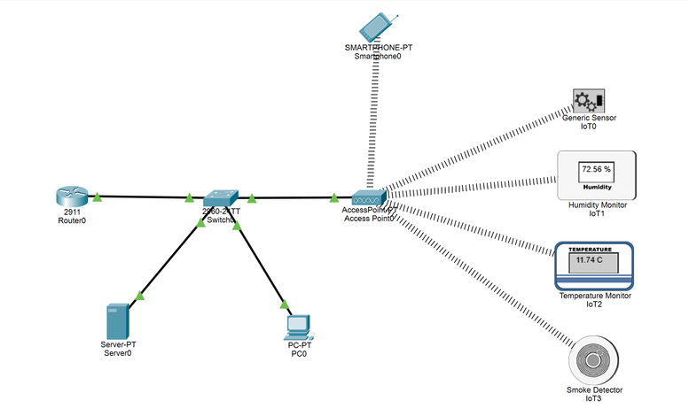
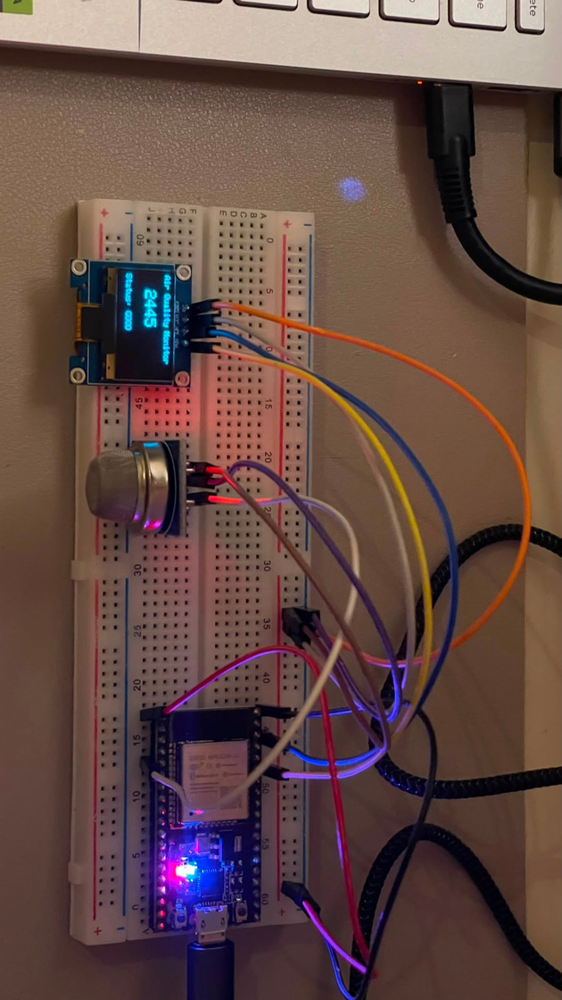
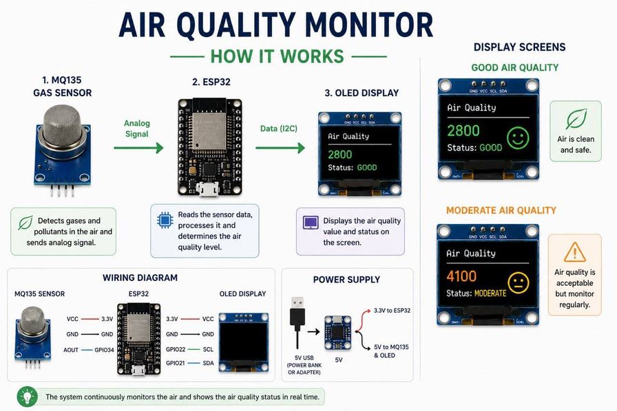

# Smart City Air Quality Monitoring Network and IoT Prototype

A smart city air quality monitoring system built in two parts: a network simulation in Cisco Packet Tracer and a physical ESP32 sensor node that reads air quality and shows it on an OLED display.

Course project for Computer Networks, Taif University, 2026.

## The problem

Conventional air quality stations are expensive to install and maintain, so they cover few locations. That makes it hard to get real-time information about where pollution is and how bad it is. This project designs a low-cost wireless sensor network that can cover more ground and report continuously.

## Network simulation

The network uses a star topology built in Cisco Packet Tracer.

| Device | Role |
| --- | --- |
| Router (2911) | Gateway for the network |
| Switch | Central point connecting the wired devices |
| Access point | Wireless link for the IoT sensors |
| Server | Central collection point for sensor data |
| PC and smartphone | Monitoring stations |
| IoT sensors | Air quality sensor, humidity monitor, temperature monitor, smoke detector |

Why a star topology:

- Easy to administer and troubleshoot
- A failed sensor does not take down the rest of the network
- New sensors can be added without redesigning anything

VLAN segmentation is planned as a next step, to put the sensors on their own VLAN. That would contain broadcast traffic and keep a compromised sensor away from the server and admin workstations.

## Hardware prototype

A single sensor node was built and tested to show the design works outside the simulator.

| Part | Details |
| --- | --- |
| Microcontroller | ESP32 NodeMCU |
| Sensor | MQ135 gas sensor |
| Display | 0.96" OLED over I2C |

Wiring:

| From | To (ESP32) |
| --- | --- |
| MQ135 AOUT | GPIO34 |
| OLED SDA | GPIO21 |
| OLED SCL | GPIO22 |

The ESP32 reads the analog signal from the MQ135, classifies the air quality, and shows the reading and status on the OLED in real time. Over Wi-Fi it also serves the latest reading as a small web page and as JSON at `/data`.

## Results

- All devices in the simulated network communicated successfully
- Sensor data reached the central server through the access point
- The physical node read and displayed air quality live

## Files

| File | What it is |
| --- | --- |
| `simulation/smart_city_network.pkt` | Cisco Packet Tracer network simulation |
| `firmware/air_quality_node/air_quality_node.ino` | ESP32 sketch for the sensor node |
| `docs/report.pdf` | Full project report |
| `figures/` | Network topology, hardware photo, and sensor node overview |

## Running it

**Simulation:** open `simulation/smart_city_network.pkt` in Cisco Packet Tracer.

**Sensor node:**

1. Open `air_quality_node.ino` in the Arduino IDE with ESP32 board support installed.
2. Install the `Adafruit SSD1306` and `Adafruit GFX Library` libraries.
3. Set your Wi-Fi name and password at the top of the sketch.
4. Upload, then open the IP address printed in the Serial Monitor.

The sketch was rewritten after the project from the documented wiring. The thresholds for GOOD, MODERATE and POOR are on the raw sensor reading and should be adjusted for your sensor.

## Author

Reema Khalid Al-boqami, Computer Engineering, Taif University
